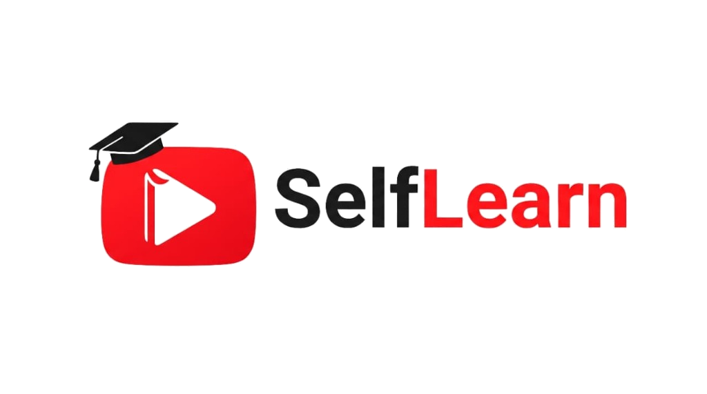

<div align="center">

  

  # 🎓 SelfLearn

  ### **Learn from YouTube. Without the noise.**

  **Convert any YouTube playlist into an isolated, distraction-free classroom with dual-level progress tracking and on-demand Ollama AI.**

  <br />

  <!-- Badges -->
  <a href="https://github.com/codeXparadise/selfLearn/stargazers">
    
  </a>
  <a href="https://github.com/codeXparadise/selfLearn/network/members">
    
  </a>
  <a href="https://github.com/codeXparadise/selfLearn/blob/main/LICENSE">
    
  </a>
  <a href="https://github.com/codeXparadise/selfLearn">
    
  </a>

  <br /><br />

  <p align="center">
    <a href="#-overview">Overview</a> •
    <a href="#-tech-stack--tools">Tech Stack</a> •
    <a href="#-core-features">Key Features</a> •
    <a href="#-vibe-coding-declaration">Vibe-Coding</a> •
    <a href="#-getting-started">Quick Start</a> •
    <a href="#-reverse-engineering-ban--legal">Legal & REA Ban</a>
  </p>

</div>

---

> [!NOTE]
> **Built with Vibe-Coding ⚡**  
> SelfLearn was engineered through deep-flow **Vibe-Coding**—blending human architectural vision, UI/UX aesthetics, and high-frequency agentic pairing to create an uncompromising, production-grade learning platform.

---

## 📖 Overview

Traditional YouTube is engineered to capture and hold your attention with algorithmic sidebars, infinite comment threads, and endless recommendations. 

**SelfLearn** is an open-source, distraction-free YouTube classroom engine. Simply paste any public or unlisted YouTube playlist link, and SelfLearn isolates the curriculum into an ad-free, locked environment with:

1. **Algorithmic Isolation**: No sidebars, no comment sections, no recommended rabbit holes.
2. **Dual-Tier Progress Tracking**: Second-level playback resumption for individual lessons + macro completion percentages across the entire curriculum.
3. **Contextual Ollama AI Tutor**: Floating frosted-glass AI drawer that answers your questions based on the video being watched, citing clickable `⏱️ [mm:ss]` timestamp jump pills.
4. **Zero-API Playlist Ingestion**: Directly scrapes durations, titles, and video metadata without requiring YouTube Data v3 API keys or Google Cloud quotas.
5. **Multi-User Isolation**: Independent Firestore collections and activity histories for every signed-in learner.

---

## 🛠 Tech Stack & Tools

SelfLearn is crafted using industry-standard modern web technologies and open-source models:

<div align="center">

| Technology | Role | Official Logo / Badge |
| :--- | :--- | :--- |
| **Next.js 14** | Core Framework (App Router & Server Actions) |  |
| **React 18** | UI Architecture & Hooks |  |
| **TypeScript** | End-to-End Type Safety |  |
| **Tailwind CSS** | Styling & Google Labs Minimalist System |  |
| **shadcn/ui** | Accessible Headless UI Primitives (Radix UI) |  |
| **Firebase** | Authentication (Google Auth + Email) & Cloud Firestore |  |
| **Ollama** | Local & Contextual LLM Runtime (`gemma4:31b`, `beam`, `nemotron`) |  |
| **Framer Motion** | Physics-Based UI Micro-Interactions |  |
| **GSAP** | High-Performance Timeline Animations |  |
| **Lenis** | Smooth Momentum Physics Scrolling |  |
| **Node.js** | Server Runtime & API Handlers |  |
| **Lucide React** | Minimalist Iconography |  |

</div>

---

## ✨ Core Features

### 🛡️ 1. Algorithmic Isolation Frame
- No recommended feeds, related videos, or comment distractions.
- Hardware-composited clean frame eliminating video blinking or black-screen glitches.
- Keyboard shortcuts (`Space`/`K` to play/pause, `J`/`L` for 10s skip, `M` to mute, `F` for fullscreen, `0-9` for percentage scrubbing).

### 📊 2. Dual-Tier Progress Architecture
- **Micro Tracker**: Saves exact second-level timestamps every few seconds. If you close your browser, you resume at the exact second you left.
- **Macro Tracker**: Real-time progress bars calculating whole-course completion percentage.
- **Auto-Next Countdown**: Automatic transition to the next lesson with an interactive 5-second cancel overlay.

### 🤖 3. On-Demand Ollama AI Tutor
- Translucent floating drawer overlay accessible anytime via the bottom FAB button.
- Clean structured Markdown rendering with copyable code blocks, syntax tags, and bold emphasis.
- Auto-injects current lesson title, instructor, and exact video timestamp into queries.
- Clickable `⏱️ [mm:ss]` timestamp jump pills let you seek the video directly from the AI's explanation.
- Supports 7 open models including Gemma 4:31B, Beam, and Nemotron.

### 📱 4. Responsive 2-Grid Mobile Layout
- **Top Grid**: Sticky video player container.
- **Bottom Grid**: Expandable/collapsible syllabus with curriculum search and individual progress bars.
- Dedicated floating AI assistant at the bottom.

---

## ⚡ Vibe-Coding Declaration

```
 __      ___ _            _____          _ _             
 \ \    / (_) |          / ____|        | (_)            
  \ \  / / _| |__   ___ | |     ___   __| |_ _ __   __ _ 
   \ \/ / | | '_ \ / _ \| |    / _ \ / _` | | '_ \ / _` |
    \  /  | | |_) |  __/| |___| (_) | (_| | | | | | (_| |
     \/   |_|_.__/ \___| \_____\___/ \__,_|_|_| |_|\__, |
                                                    __/ |
                                                   |___/ 
```

This codebase was developed utilizing modern **Vibe-Coding** practices:
- Rapid architectural iterations guided by developer vision.
- Zero boilerplate lag with immediate, verified build steps.
- High focus on user experience, tactile animations, and fluid transitions.

---

## 🚀 Getting Started

### Prerequisites
- [Node.js](https://nodejs.org/) (v18.17 or higher)
- [npm](https://www.npmjs.com/) or [pnpm](https://pnpm.io/)
- (Optional) [Ollama](https://ollama.com/) running locally on port `11434` for offline AI

### 1. Clone the Repository
```bash
git clone https://github.com/codeXparadise/selfLearn.git
cd selfLearn
```

### 2. Install Dependencies
```bash
npm install
```

### 3. Setup Environment Variables
Copy `.env.example` to `.env`:
```bash
cp .env.example .env
```
Add your Firebase Web Credentials from the [Firebase Console](https://console.firebase.google.com/):
```env
NEXT_PUBLIC_FIREBASE_API_KEY=your_key
NEXT_PUBLIC_FIREBASE_AUTH_DOMAIN=your_project.firebaseapp.com
NEXT_PUBLIC_FIREBASE_PROJECT_ID=your_project_id
NEXT_PUBLIC_FIREBASE_STORAGE_BUCKET=your_project.firebasestorage.app
NEXT_PUBLIC_FIREBASE_MESSAGING_SENDER_ID=your_id
NEXT_PUBLIC_FIREBASE_APP_ID=your_app_id
```

### 4. Run Development Server
```bash
npm run dev
```
Open [http://localhost:3000](http://localhost:3000) to view the application.

### 5. Production Build
```bash
npm run build
npm start
```

---

## 📁 Project Architecture

```
selfLearn/
├── public/                  # Logo, icons, favicon, Ollama assets
├── src/
│   ├── app/
│   │   ├── classroom/[id]/  # Distraction-free classroom player
│   │   ├── dashboard/       # User course hub & playlist manager
│   │   ├── profile/         # Settings, stats, AI model config
│   │   ├── api/
│   │   │   ├── ai/chat/     # Ollama AI streaming endpoint
│   │   │   ├── courses/     # YouTube playlist scraper & courses CRUD
│   │   │   └── auth/        # Per-user auth & activity sessions
│   │   ├── page.tsx         # Google Labs minimalist single-page landing
│   │   └── layout.tsx       # Root layout & providers
│   ├── components/
│   │   ├── VideoPlayer.tsx  # YouTube IFrame player with zero-jitter compositing
│   │   ├── AIPanel.tsx      # Frosted-glass Ollama AI drawer
│   │   ├── MarkdownRenderer.tsx # Custom markdown with code copy & timestamp pills
│   │   ├── Navbar.tsx       # Context-aware dynamic navigation
│   │   └── Logo.tsx         # Unified SVG/PNG brand emblem
│   ├── context/             # AuthContext & ThemeContext
│   └── lib/                 # Firebase client & database utilities
├── data/                    # Seed courses & local storage
├── LICENSE                  # MIT License + REA Tool Ban
├── CODE_OF_CONDUCT.md       # Contributor Covenant v2.1
└── COPYRIGHT.md             # Intellectual property & Reverse Engineering notice
```

---

## ⚖️ Reverse Engineering Ban & Legal Notice

> [!CAUTION]
> **REA (Reverse Engineer Anything) Tool & Automated Decompilation Prohibition**  
> Under the terms of the project's [LICENSE](file:///c:/Users/smart/OneDrive/Desktop/selfLearn/LICENSE) and [COPYRIGHT.md](file:///c:/Users/smart/OneDrive/Desktop/selfLearn/COPYRIGHT.md), any use of automated reverse engineering agents, decompilation harnesses, or **REA ("Reverse Engineer Anything")** inspection pipelines to systematically extract, clone, decompile, or harvest this codebase or its application mechanics without express written permission from the author is **strictly forbidden**.

- **License**: [MIT License](file:///c:/Users/smart/OneDrive/Desktop/selfLearn/LICENSE) with Protective Addendum.
- **Code of Conduct**: [Contributor Covenant v2.1](file:///c:/Users/smart/OneDrive/Desktop/selfLearn/CODE_OF_CONDUCT.md).
- **Trademark Notice**: YouTube™ is a trademark of Google LLC. SelfLearn is an independent project and is not affiliated with or endorsed by YouTube or Google LLC.

---

<div align="center">
  <p><b>Crafted with ❤️ by <a href="https://github.com/codeXparadise">Vishal Prajapati (@codeXparadise)</a> via Vibe-Coding ⚡</b></p>
  <p>Star ⭐ this repo if you find it helpful!</p>
</div>
