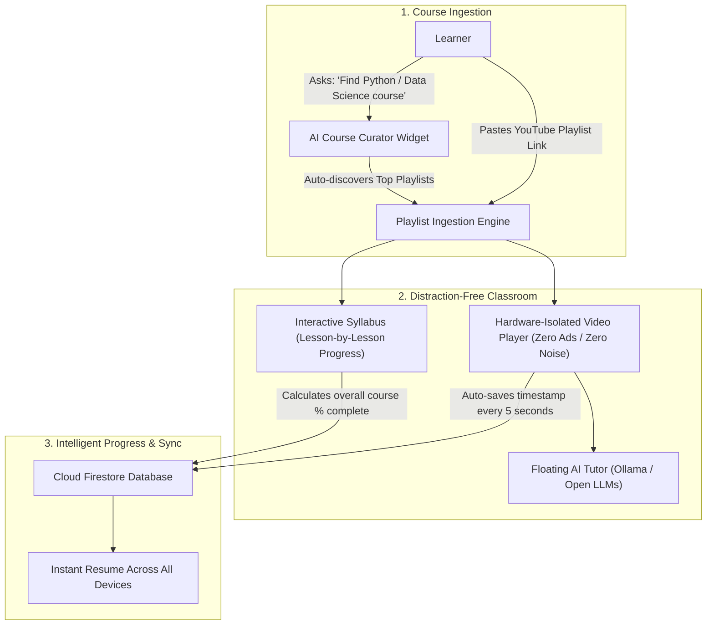
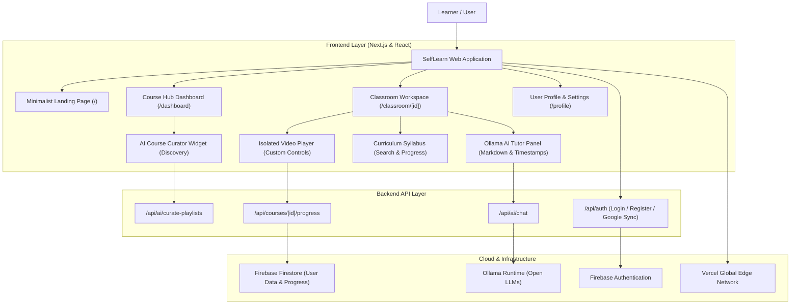

<div align="center">

  

  # 🎓 SelfLearn

  ### **Learn from YouTube. Without the noise.**

  **Convert any YouTube playlist into an isolated, distraction-free classroom with dual-level progress tracking and an on-demand AI tutor.**

  <br />

  ### 🌐 **Live Application**
  👉 **[Self Learn — Distraction-Free YouTube Classroom & AI Course Hub](https://self-learn-cyan.vercel.app/)** 👈

  <br />

  <!-- Badges -->
  <a href="https://self-learn-cyan.vercel.app/">
    
  </a>
  <a href="https://github.com/codeXparadise/selfLearn/stargazers">
    
  </a>
  <a href="https://github.com/codeXparadise/selfLearn/blob/main/LICENSE">
    
  </a>
  <a href="https://github.com/codeXparadise/selfLearn">
    
  </a>

  <br /><br />

  <p align="center">
    <a href="#-what-is-selflearn">What is SelfLearn?</a> •
    <a href="#-how-it-works-workflow">How It Works</a> •
    <a href="#-tech-stack">Tech Stack</a> •
    <a href="#-features-at-a-glance">Features</a> •
    <a href="#-architecture-tree">Architecture</a> •
    <a href="#-vibe-coding">Vibe-Coding</a> •
    <a href="#-quick-start">Quick Start</a> •
    <a href="#-legal--reverse-engineering-ban">Legal & REA Ban</a>
  </p>

</div>

---

> [!NOTE]
> **Built with Vibe-Coding ⚡**  
> SelfLearn was engineered through deep-flow **Vibe-Coding**—combining architectural clarity, intuitive UI/UX design, and AI-accelerated development to deliver a fast, reliable, production-grade learning platform.

---

## 💡 What is SelfLearn? (In Plain English)

Have you ever opened YouTube to learn coding or study a new subject, only to get sidetracked by recommended videos, clickbait thumbnails, or comments?

**SelfLearn solves this completely.**

1. You paste **any YouTube playlist link** (or ask our AI curator to find the best course for you).
2. SelfLearn strips away **all distractions**—no recommendations, no ads, no comment sections, and no algorithmic rabbit holes.
3. You get a **clean, structured classroom** with a syllabus sidebar, real-time progress bars, and an AI tutor that can answer questions about what's being taught or summarize the whole lesson for you.
4. When you leave and come back, it resumes playing at the **exact second** you left off.

---

## 🔄 How It Works (Workflow Diagram)

Here is a visual overview of how SelfLearn takes you from discovering a course to mastering it:



---

## 🛠 Tech Stack

A breakdown of every technology powering SelfLearn and its role in the system:

| Technology / Service | What It Does (Role) | Official Logo |
| :--- | :--- | :---: |
| **Next.js 14** | Core full-stack web framework (App Router & Server Actions) |  |
| **React 18** | Interactive user interface components and state hooks |  |
| **TypeScript** | Strict end-to-end type safety preventing runtime bugs |  |
| **Firebase** | User Authentication (Google Sign-In + Email/Password) & Cloud Firestore Database |  |
| **Vercel** | Global edge hosting, serverless execution, and deployment |  |
| **Ollama** | LLM runtime powering the AI Tutor (`gemma4:31b`, `beam`, `nemotron`) |  |
| **Tailwind CSS** | Minimalist styling, dark/light themes, and Google Labs design system |  |
| **Framer Motion** | Glassmorphism blur effects, modal animations, and tactile transitions |  |
| **Node.js** | Backend server runtime and YouTube metadata parser |  |
| **Lucide Icons** | Ultra-clean iconography across video player and navigation |  |

---

## 🎯 Features at a Glance

- 🚫 **100% Distraction-Free Player**  
  No recommended video feeds, no sidebars, no autoplaying rabbit holes, and no comment sections.
- ⏱️ **Second-Level Playback Resumption**  
  Never lose your spot. Pause at 08:59, close your browser, and it resumes at 08:59 when you return.
- 📊 **Dual Progress Tracking**  
  Track individual lesson progress (0% to 100%) and whole-course completion percentages.
- 🤖 **Context-Aware AI Tutor**  
  - Ask questions about the specific second you are watching (`⏱️ Synced at mm:ss`).
  - Or switch to `🌐 Full Video / General` mode to get a complete, structured summary of the entire lesson in seconds.
  - Cites clickable timestamp jump pills (e.g. `⏱️ 02:30`) that seek the video immediately.
- 🔍 **AI Course Curator on Dashboard**  
  Don't know what course to take? Type any topic (e.g., *Python, Machine Learning, React*) and the AI will find, rank, and import complete YouTube playlists for you.
- ⚡ **Zero YouTube API Quota Needed**  
  Scrapes video durations, titles, and thumbnails directly without burning through Google Cloud API quotas.
- ⌨️ **Pro Keyboard Shortcuts**  
  - `Space` / `K`: Play / Pause
  - `←` / `J` & `→` / `L`: Skip 10 seconds backward / forward
  - `↑` / `↓`: Volume adjustment
  - `M`: Mute / Unmute
  - `N` / `P`: Next / Previous lesson in syllabus
  - `F`: Fullscreen toggle
  - `R`: Instant player screen reload
  - `0 - 9`: Jump to 0% - 90% of video
  - `?`: Open keyboard shortcuts cheat sheet
- 🌓 **Smooth Dark & Light Mode**  
  Automatic or manual switching between minimalist dark and clean white themes.

---

## 🌲 Architecture Tree

The visual architecture of SelfLearn connecting user actions to cloud services:



---

## ⚡ Vibe-Coding

```
 __      ___ _            _____          _ _             
 \ \    / (_) |          / ____|        | (_)            
  \ \  / / _| |__   ___ | |     ___   __| |_ _ __   __ _ 
   \ \/ / | | '_ \ / _ \| |    / _ \ / _` | | '_ \ / _` |
    \  /  | | |_) |  __/| |___| (_) | (_| | | | | | (_| |
     \/   |_|_.__/ \___| \_____\___/ \__,_|_|_| |_|\__, |
                                                    __/ |
                                                   |___/ 
```

SelfLearn is a proud demonstration of modern **Vibe-Coding**:
- Built rapidly through deep flow and agentic collaboration.
- Continuous real-time feedback loops between vision, design, and execution.
- Delivering a refined, human-centric learning tool free of corporate clutter.

---

## 🚀 Quick Start (For Developers)

### 1. Clone the Repository
```bash
git clone https://github.com/codeXparadise/selfLearn.git
cd selfLearn
```

### 2. Install Dependencies
```bash
npm install
```

### 3. Setup Environment Variables
Create a `.env` file in the root directory (refer to `.env.example`):
```env
# Firebase Web App Credentials
NEXT_PUBLIC_FIREBASE_API_KEY=your_firebase_api_key
NEXT_PUBLIC_FIREBASE_AUTH_DOMAIN=your_project.firebaseapp.com
NEXT_PUBLIC_FIREBASE_PROJECT_ID=your_project_id
NEXT_PUBLIC_FIREBASE_STORAGE_BUCKET=your_project.firebasestorage.app
NEXT_PUBLIC_FIREBASE_MESSAGING_SENDER_ID=your_sender_id
NEXT_PUBLIC_FIREBASE_APP_ID=your_app_id

# Auth Secret for Stateless Sessions
JWT_SECRET=your_secure_random_secret_string
```

### 4. Run Locally
```bash
npm run dev
```
Open [http://localhost:3000](http://localhost:3000) in your browser.

---

## ⚖️ Legal & Reverse Engineering Ban

> [!CAUTION]
> **REA (Reverse Engineer Anything) Tool & Automated Decompilation Prohibition**  
> Under the terms of the project's [LICENSE](file:///c:/Users/smart/OneDrive/Desktop/selfLearn/LICENSE) and [COPYRIGHT.md](file:///c:/Users/smart/OneDrive/Desktop/selfLearn/COPYRIGHT.md), any use of automated reverse engineering agents, decompilation harnesses, or **REA ("Reverse Engineer Anything")** inspection pipelines to systematically extract, clone, decompile, or harvest this codebase or its application mechanics without express written permission from the author is **strictly forbidden**.

- **License**: [MIT License](file:///c:/Users/smart/OneDrive/Desktop/selfLearn/LICENSE) with Protective Addendum.
- **Code of Conduct**: [Contributor Covenant v2.1](file:///c:/Users/smart/OneDrive/Desktop/selfLearn/CODE_OF_CONDUCT.md).
- **Trademark Notice**: YouTube™ is a trademark of Google LLC. SelfLearn is an independent project and is not affiliated with or endorsed by YouTube or Google LLC.

---

<div align="center">
  <p><b>Crafted with ❤️ by <a href="https://github.com/codeXparadise">Vishal Prajapati (@codeXparadise)</a> via Vibe-Coding ⚡</b></p>
  <p>Star ⭐ this repo if you find it helpful!</p>
</div>
